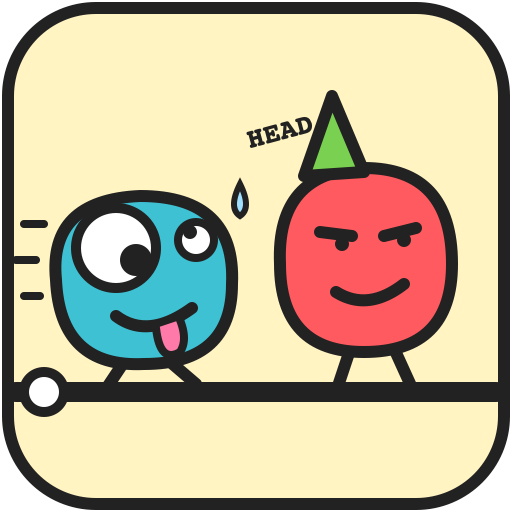
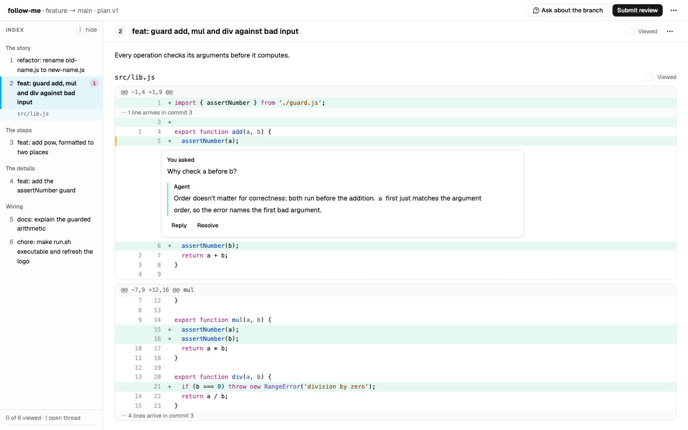
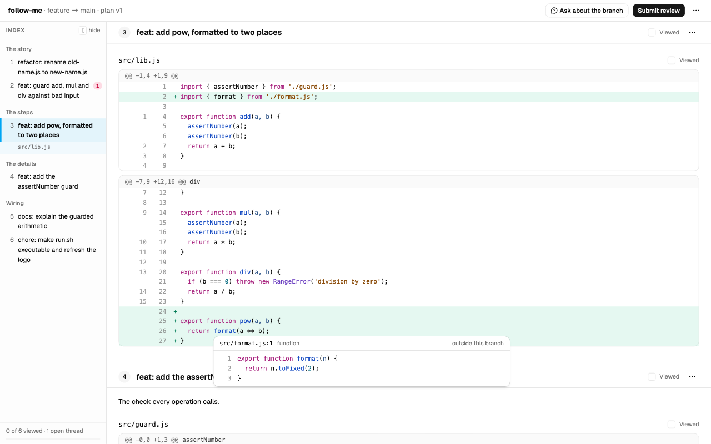
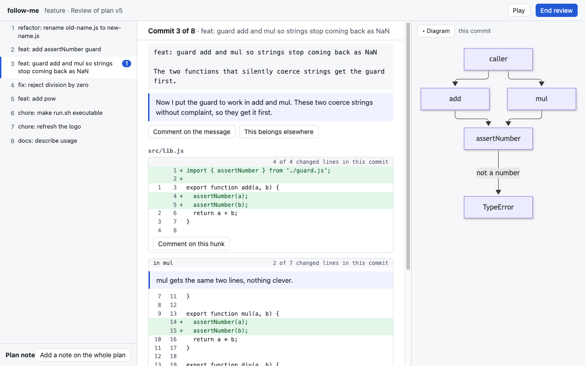
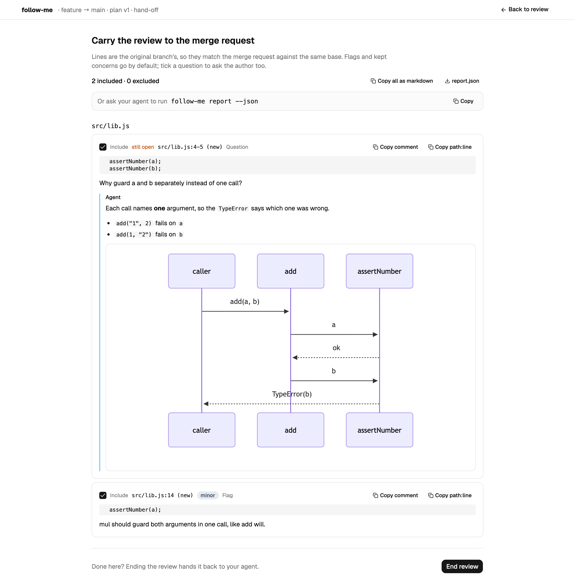

<p align="center"></p>

# follow-me

follow-me splits a branch's net change into small commits in an order a reader can follow, proves the result equals the original, and lets you review it line by line.

[](https://www.npmjs.com/package/@shiyuphan/follow-me)
[](https://github.com/phanshiyu/follow-me/actions/workflows/ci.yml)

## Why

People commit in the order things happened: wip, fix, actually fix, revert. A reviewer then reads that history or gives up and reads one big diff. Neither shows how the change was thought through.

The blob with its tongue out is you, on commit 31 of someone's 47-commit branch.

follow-me is for two people:

- **The author** commits however they like, then wants a branch that reads like a story before asking for review.
- **The reviewer** wants to read someone else's branch in an order that makes sense, ask questions about it, and post the review to the merge request.

## Use it

You do not run follow-me yourself. Your coding agent does.

1. Install it once, with Node 24 or newer and git: `npm i -g @shiyuphan/follow-me`.
2. Tell your agent to review a branch with follow-me. The first time it runs, follow-me copies its skill into the skill directory of every agent it finds (Claude Code, OpenCode, Codex CLI, Cursor, Gemini CLI, GitHub Copilot CLI), so every repo sees it. The agent plans the commits, and a review page opens in your browser.
3. Use the page. Read the commits in order, flag what is wrong, ask what you do not understand. Questions go to the agent at once and it answers under them. Flags are held until you press **Submit**.
4. Tell the agent to post the review. It reads `follow-me report --json` and posts the items you did not exclude to your GitLab merge request or GitHub pull request with `glab` or `gh`. follow-me never holds a token.

follow-me never calls a model and holds no API key; your agent writes the plan. [Using follow-me from your coding agent](docs/harnesses.md) has the per-harness details. `follow-me uninstall` removes exactly the skill files the agent run wrote.

## What the agent runs

An agent runs `follow-me` with no command, again and again. Each call does the next thing that is missing and ends with a `next:` line: it writes `.follow-me/<branch>/prompt.md` for the agent to answer, prints the problems with the agent's draft, applies a valid draft to `<branch>-split` and opens the page, then listens to the reviewer for up to 60 seconds (`--wait <seconds>`) and prints what they flagged or asked. When the reviewer submits it prints the report. `follow-me help` lists the other commands an agent uses (`reply`, `explain`, `report`); `follow-me help --all` lists the steps by hand:

### Splitting your own branch

With the branch checked out, from the repo root:

```sh
follow-me split --base main     # extract, apply your agent's draft and open the review in one go
```

Until there is a valid draft, `split` writes `.follow-me/<branch>/prompt.md` and stops: the agent follows it, then runs `follow-me check` and `follow-me split` again. Every command ends with a `next:` line naming the step after it. The steps `split` runs are also commands of their own:

```sh
follow-me extract --base main   # snapshot the diff from main to the tip, list the units
follow-me prompt                # instructions and every unit, for your coding agent
                                # the agent writes .follow-me/<branch>/draft.json
follow-me check                 # print every problem with the draft at once
follow-me apply                 # write the commits to <branch>-split
follow-me review                # open the review page in your browser
follow-me report [--json]       # print the review as markdown, or as items to post
```

A unit is a text hunk (`h_…`), a whole file that cannot be split by line (`f_…`), or a mode change (`m_…`). The draft assigns every change line to exactly one commit. `h_x:0-3,7` takes change lines 0 to 3 and 7 of hunk `h_x`, so one hunk can spread across several commits.

`check` and `apply` also parse every file each commit writes, so a split can leave a commit that does not build but never one that ends inside a function. `.js`, `.ts`, `.json`, `.sh` and `.py` files are checked and other types are listed as skipped; `--syntax "<command with {file}>"` swaps in your own checker and `apply --allow-syntax-errors` goes ahead anyway. Without an agent, `follow-me plan --naive` writes one `wip: <path>` commit per touched file, which is enough to run `check`, `apply` and the tree proof on any branch.

`apply` never writes your original branch, your index, or your working tree. It builds the commits in a temporary index and points `<branch>-split` at them, or the branch you name with `--name`. It refuses the branch being split and any branch checked out in a worktree, even with `--force`. `--force` only lets it move a branch follow-me did not create. Then it compares the last commit's tree hash with the original tip's and prints both:

```text
created feature-split at c90eb5350284 from plan v1 (3 commits)
signing: off
proof: feature-split^{tree} ae948488c55a3606fa2419eb1c018fff8014093d equals feature^{tree} ae948488c55a3606fa2419eb1c018fff8014093d
```

If the hashes differ, `apply` exits with code 1. The commits are signed when your git config signs commits (`commit.gpgsign`), and `--sign` or `--no-sign` overrides that. Running `apply` again with the same plan prints `unchanged` and leaves the branch alone, signed or not.

The red blob in the party hat is your branch tip. Nothing follow-me does moves it.


*The review page. The index groups the commits the way they read: the story first, then the steps it calls, then the details. Pick any line, changed or not, and Ask or Flag right under it; the agent answers inline.*


*Cmd-click a name to jump to where it is defined, even in a later commit, and Alt+Left to come back. A definition the branch does not change opens as a peek.*


*Diagrams sit full width under the commit or reply they explain, and open full size on click.*


*Submit review. Each item carries the original branch's path and line, so your agent can post it to the merge request as is.*

Keys: `[` shows or hides the index, `j` and `k` move between commits, Cmd-click (Ctrl-click) goes to a definition and Alt+Left comes back, arrows and Shift+arrows pick rows inside a hunk, `c` comments on the pick, `v` marks a commit viewed, `?` lists the rest. An unfinished review autosaves and comes back when the page is opened again.

### Reviewing someone else's branch

When the branch is not yours, `follow-me` plans a reading order instead of a split: nothing is applied and no branch is written. You read the commits in order and comment on the code, and `follow-me report` prints it as a code review for the author, grouped by file, with each comment quoting its hunk as it reads in that commit and its line number on the branch. `--reviewer` and `--author` override the guess, which is whether you wrote every commit of the branch.

### One server for every review

The first review starts a review server for your user and serves the page. Every later one, from any repo or worktree, adds its session to that server, prints the URL, and exits. The server's index page lists every open session.

```sh
follow-me review --detach       # start the server in the background and return
follow-me review --no-open      # print the URL without opening a browser
follow-me review --wait         # return only once the review ends, so an agent can go on to report
follow-me server status         # the server, its port, and the sessions it hosts
follow-me server stop           # stop it, autosaved reviews are kept
```

The server listens on `127.0.0.1` only. If the `--port` you ask for is taken by another program, it picks a free port and prints `port N is in use by another program, using M`. It exits on its own 30 seconds after its last session ends. It is the only one at the party who knows when to leave. Its record lives in `$FOLLOW_ME_HOME`, else `$XDG_STATE_HOME/follow-me`, else `~/.local/state/follow-me`.

Each worktree has its own `.follow-me/` directory, which git ignores, and each branch has its own session in it. A lock stops two agents from applying or reviewing one session at once. `follow-me clean` removes what no live session needs: sessions of deleted branches, review drafts that a finished review replaced, and locks and temp files of dead processes. It keeps plan versions, because reviews refer to them. `clean --dry-run` lists what it would remove, and `clean --all` removes `.follow-me/` entirely unless a live process holds a session.

### How it works

Every unit comes from one `git diff base..tip`, so the hunks of a file never overlap in base coordinates. A commit's version of a file is therefore the base lines with that commit's change lines swapped in. Nothing is patched. Hunks can go in any order and split at any line, and nothing can fail to apply.

Two checks replace patching. While parsing, every context line and removed line must equal the base file at its position. After the last commit, every path's bytes and mode must equal the tip, and then git's own tree hash is compared once more.

There is one limit. A commit can only contain lines that exist in the base or in the tip, so follow-me cannot invent an intermediate version of a line that the author typed and later deleted.

[docs/DESIGN.md](docs/DESIGN.md) has the full design.

### The agent loop

Each `apply` freezes the draft as the next plan version, `.follow-me/<branch>/plans/vN.json`. Each review belongs to one version. `follow-me report` gives every comment an id like `c_abc234`. After a review, `follow-me prompt` includes the previous plan and the open comments, and the agent answers each comment in the next draft:

```json
"responses": [
  { "comment": "c_abc234", "status": "addressed", "note": "Moved the guard before its first use." }
]
```

`status` is `addressed`, `declined`, or `deferred`. A comment counts as answered once a later plan lists it. `check` warns about unanswered comments but does not block `apply`. `follow-me status` shows the plans, the reviews, how many comments are still open, and the branch `apply` writes.

## Upgrade and uninstall

```sh
follow-me upgrade               # npm install -g @shiyuphan/follow-me@latest, then refresh the skill copies
follow-me uninstall --all       # remove the skill from every agent's skill directory
npm uninstall -g @shiyuphan/follow-me
```

`upgrade` matters because the skill copies in `~/.claude/skills/` and the other agents' directories
are files, so they stay at the old version until they are written again. Uninstalling the package
leaves per-repo state in `.follow-me/` (remove it with `follow-me clean --all` first, or delete the
directory) and the server record under `~/.local/state/follow-me`.

## Development

```sh
npm install
npm run check                   # biome, strict tsc, and node --test, the same as CI
node bin/follow-me.ts <command> # run the CLI from source
```

There is no build step for development. Node 24 runs the TypeScript sources directly, and `npm run build` exists only for publishing. Tests run real git against repositories built by `test/fixture-repo.ts`. Non-obvious decisions go in `docs/decisions.tsv` through `scripts/log-decision.sh`.

To release, run `npm version patch`, `minor`, or `major`, then `git push --follow-tags`. The tag triggers the publish workflow. [docs/releasing.md](docs/releasing.md) has the details.

## Credits

Inspired by the "split your own changes" idea in [spark-joy](https://github.com/Dansyuqri/spark-joy). Built with [pstack](https://github.com/alexanderop/pstack).

MIT licensed.
