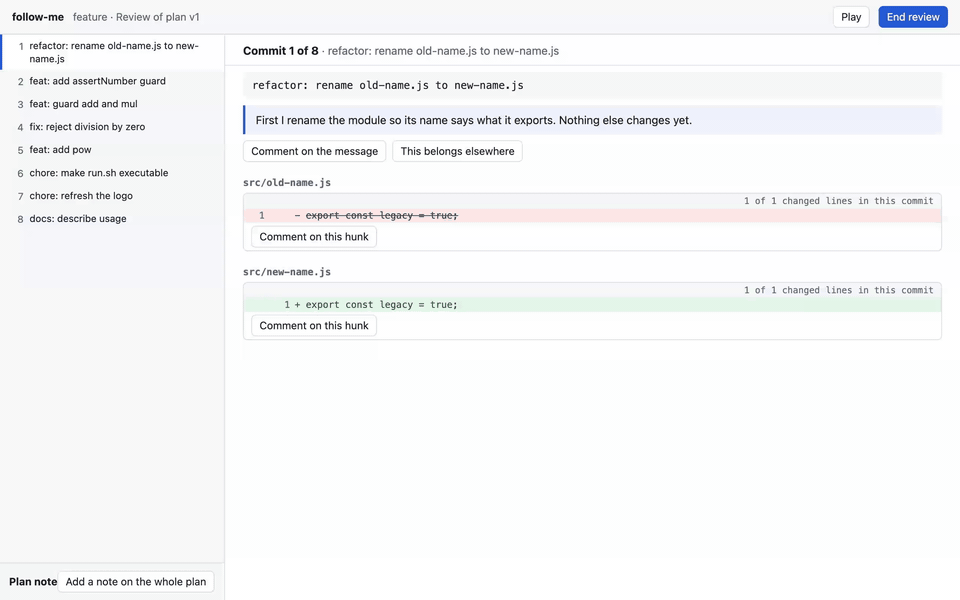
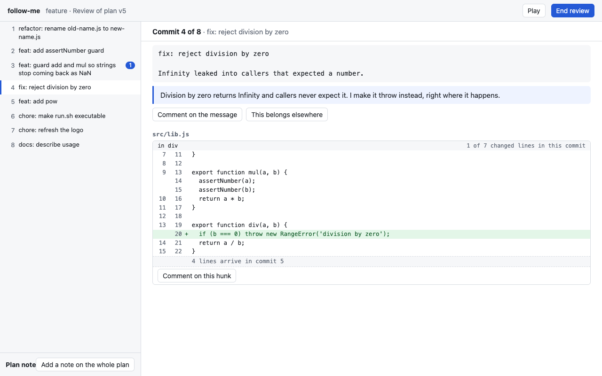
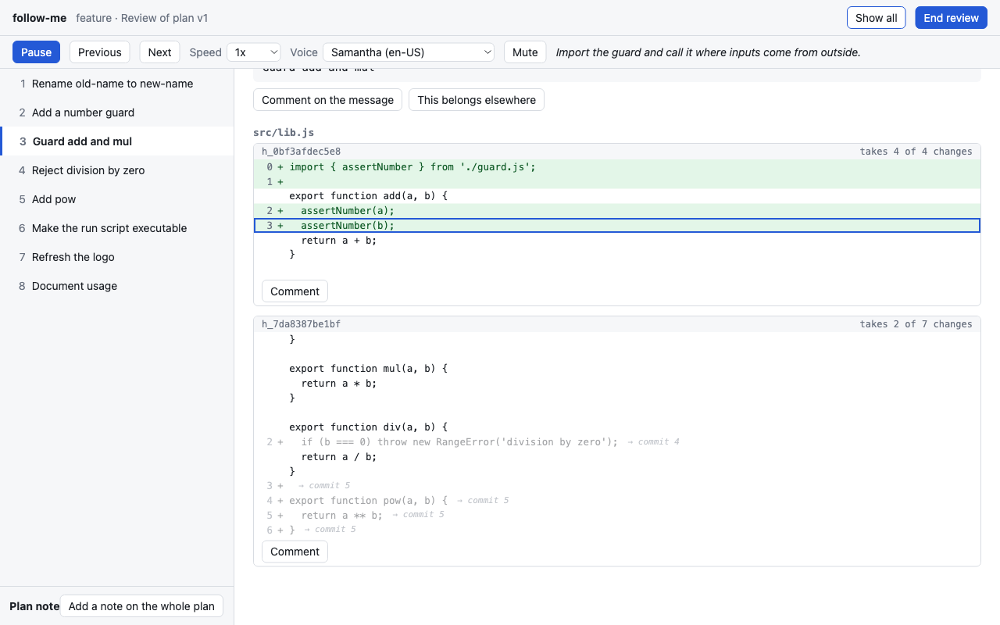

<p align="center"></p>

# follow-me

follow-me splits a branch's net change into small commits in an order a reader can follow, proves the result equals the original, and lets you review it line by line.

[](https://www.npmjs.com/package/@shiyuphan/follow-me)
[](https://github.com/phanshiyu/follow-me/actions/workflows/ci.yml)

<p align="center"></p>

*Playback at 1x, sped up 1.5 times for the GIF. The voice is not in the GIF; the browser reads the narration aloud.*

## Why

People commit in the order things happened: wip, fix, actually fix, revert. A reviewer then reads that history or gives up and reads one big diff. Neither shows how the change was thought through.

The blob with its tongue out is you, on commit 31 of someone's 47-commit branch.

follow-me is for two people:

- **The author** commits however they like, then wants a branch that reads like a story before asking for review.
- **The reviewer** wants to watch someone else's branch being written, one line at a time, with the author's reasoning read aloud.

## Install

You need Node 24 or newer and git.

```sh
npm i -g @shiyuphan/follow-me
```

follow-me ships an Agent Skill that teaches a coding agent to drive the CLI. Install it once:

```sh
follow-me install
```

`install` looks in your home directory for the config directories of Claude Code, OpenCode, Codex CLI, Cursor, Gemini CLI, and GitHub Copilot CLI. It copies the skill into the user-level skill directory of each one it finds, for example `~/.claude/skills/follow-me/SKILL.md`, so every repo sees it. Add `--project` to install into the current repo instead. Other flags are `--harness claude,codex`, `--all`, and `--dry-run`.

```sh
follow-me install --list    # each harness, where its skill goes, and its docs
follow-me uninstall         # removes exactly the files install writes
```

[Using follow-me from your coding agent](docs/harnesses.md) has the per-harness details.

## Split your own branch

Check out the branch you want to split and run this from the repo root:

```sh
follow-me split --base main     # extract, draft, apply and open the review in one go
```

With an Anthropic key in the environment, `split` asks the API for the draft. Without one, it writes `.follow-me/<branch>/prompt.md` and stops: ask your coding agent to follow it, then run `follow-me check` and `follow-me split` again. Every command ends with a `next:` line naming the step after it. The steps `split` runs are also commands of their own:

```sh
follow-me extract --base main   # snapshot the diff from main to the tip, list the units
follow-me prompt                # instructions and every unit, for your coding agent
                                # the agent writes .follow-me/<branch>/draft.json
follow-me check                 # print every problem with the draft at once
follow-me apply                 # write the commits to <branch>-split
follow-me review                # open the review page in your browser
follow-me feedback              # print the review as markdown for the agent
```

A unit is a text hunk (`h_…`), a whole file that cannot be split by line (`f_…`), or a mode change (`m_…`). The draft assigns every change line to exactly one commit. `h_x:0-3,7` takes change lines 0 to 3 and 7 of hunk `h_x`, so one hunk can spread across several commits.

If you skip the agent, `follow-me plan` asks the Anthropic API for the draft. It needs `ANTHROPIC_API_KEY` or `ANTHROPIC_AUTH_TOKEN` in the environment, and takes `--model <id>`.

`check` and `apply` also parse every file each commit writes, so a split can leave a commit that does not build but never one that ends inside a function. `.js`, `.ts`, `.json`, `.sh` and `.py` files are checked and other types are listed as skipped; `--syntax "<command with {file}>"` swaps in your own checker and `apply --allow-syntax-errors` goes ahead anyway. With no API key and no agent, `follow-me plan --naive` writes one `wip: <path>` commit per touched file, which is enough to run `check`, `apply` and the tree proof on any branch.

`apply` never writes your original branch, your index, or your working tree. It builds the commits in a temporary index and points `<branch>-split` at them, or the branch you name with `--name`. It refuses the branch being split and any branch checked out in a worktree, even with `--force`. `--force` only lets it move a branch follow-me did not create. Then it compares the last commit's tree hash with the original tip's and prints both:

```text
created feature-split at c90eb5350284 from plan v1 (3 commits)
signing: off
proof: feature-split^{tree} ae948488c55a3606fa2419eb1c018fff8014093d equals feature^{tree} ae948488c55a3606fa2419eb1c018fff8014093d
```

If the hashes differ, `apply` exits with code 1. The commits are signed when your git config signs commits (`commit.gpgsign`), and `--sign` or `--no-sign` overrides that. Running `apply` again with the same plan prints `unchanged` and leaves the branch alone, signed or not.

The red blob in the party hat is your branch tip. Nothing follow-me does moves it.


*The review page. Pick a commit on the left. Comment on its message, its position ("This belongs elsewhere"), a hunk, or single lines.*


*One hunk split across commits. Commit 3 takes 2 of 7 change lines. The others are dimmed and marked "→ commit 4" or "→ commit 5".*

On the review page, `n` or `j` goes to the next commit, `p` or `k` to the previous one. **End review** saves `.follow-me/<branch>/reviews/vN.json`. An unfinished review autosaves and comes back when you open the session again.

## Watch someone else's branch

Check out their branch and run:

```sh
follow-me walk --base main
```

`walk` extracts the branch and plans it as a narrated story. With an Anthropic key in the environment it asks the API. Without one, it prints `follow-me prompt --walk` for your coding agent, and you run `follow-me walk` again once the agent's draft passes `follow-me check`. `walk` applies nothing and writes no branch.


*Playback. Each line types in while the narration for its commit or hunk is read aloud. The caption shows the narration being read.*

Playback goes commit by commit. Space pauses, **Previous** and **Next** move between commits, and you can change the speed, pick a voice, or mute. Pause on any line to comment on it. Narration uses the browser's built-in speech synthesis, so it needs no key and no network.

When you end the review, `follow-me feedback --walk` prints it as a code review for the author, grouped by file. Code reviews are saved apart from the author's plan reviews, in `.follow-me/<branch>/reviews/walk/vN.json`, so you can walk a plan the author already reviewed. Each comment quotes its hunk as it reads in that commit, with the line number on the branch. The author's agent fixes the branch itself. A walk review never feeds the split loop below.

## One server for every review

The first `review` or `walk` starts a review server for your user and serves the page. Every later `review` or `walk`, from any repo or worktree, adds its session to that server, prints the URL, and exits. The server's index page lists every open session.

```sh
follow-me review --detach       # start the server in the background and return
follow-me review --no-open      # print the URL without opening a browser
follow-me review --wait         # return only once the review ends, so an agent can go on to feedback
follow-me server status         # the server, its port, and the sessions it hosts
follow-me server stop           # stop it, autosaved reviews are kept
```

The server listens on `127.0.0.1` only. If the `--port` you ask for is taken by another program, it picks a free port and prints `port N is in use by another program, using M`. It exits on its own 30 seconds after its last session ends. It is the only one at the party who knows when to leave. Its record lives in `$FOLLOW_ME_HOME`, else `$XDG_STATE_HOME/follow-me`, else `~/.local/state/follow-me`.

Each worktree has its own `.follow-me/` directory, which git ignores, and each branch has its own session in it. A lock stops two agents from applying or reviewing one session at once. `follow-me clean` removes what no live session needs: sessions of deleted branches, review drafts that a finished review replaced, and locks and temp files of dead processes. It keeps plan versions, because reviews refer to them. `clean --dry-run` lists what it would remove, and `clean --all` removes `.follow-me/` entirely unless a live process holds a session.

## How it works

Every unit comes from one `git diff base..tip`, so the hunks of a file never overlap in base coordinates. A commit's version of a file is therefore the base lines with that commit's change lines swapped in. Nothing is patched. Hunks can go in any order and split at any line, and nothing can fail to apply.

Two checks replace patching. While parsing, every context line and removed line must equal the base file at its position. After the last commit, every path's bytes and mode must equal the tip, and then git's own tree hash is compared once more.

There is one limit. A commit can only contain lines that exist in the base or in the tip, so follow-me cannot invent an intermediate version of a line that the author typed and later deleted.

[docs/DESIGN.md](docs/DESIGN.md) has the full design.

## The agent loop

Each `apply` freezes the draft as the next plan version, `.follow-me/<branch>/plans/vN.json`. Each review belongs to one version. `follow-me feedback` gives every comment an id like `c_abc234`. After a review, `follow-me prompt` includes the previous plan and the open comments, and the agent answers each comment in the next draft:

```json
"responses": [
  { "comment": "c_abc234", "status": "addressed", "note": "Moved the guard before its first use." }
]
```

`status` is `addressed`, `declined`, or `deferred`. A comment counts as answered once a later plan lists it. `check` warns about unanswered comments but does not block `apply`. `follow-me status` shows the plans, the reviews, how many comments are still open, and the branch `apply` writes.

## Upgrade and uninstall

```sh
follow-me upgrade               # npm install -g @shiyuphan/follow-me@latest, then refresh the skill copies
follow-me uninstall --all       # remove the skill from every agent's skill directory
npm uninstall -g @shiyuphan/follow-me
```

`upgrade` matters because the skill copies in `~/.claude/skills/` and the other agents' directories
are files, so they stay at the old version until they are written again. Uninstalling the package
leaves per-repo state in `.follow-me/` (remove it with `follow-me clean --all` first, or delete the
directory) and the server record under `~/.local/state/follow-me`.

## Development

```sh
npm install
npm run check                   # biome, strict tsc, and node --test, the same as CI
node bin/follow-me.ts <command> # run the CLI from source
```

There is no build step for development. Node 24 runs the TypeScript sources directly, and `npm run build` exists only for publishing. Tests run real git against repositories built by `test/fixture-repo.ts`. Non-obvious decisions go in `docs/decisions.tsv` through `scripts/log-decision.sh`.

To release, run `npm version patch`, `minor`, or `major`, then `git push --follow-tags`. The tag triggers the publish workflow. [docs/releasing.md](docs/releasing.md) has the details.

## Credits

Inspired by the "split your own changes" idea in [spark-joy](https://github.com/Dansyuqri/spark-joy). Built with [pstack](https://github.com/alexanderop/pstack).

MIT licensed.
